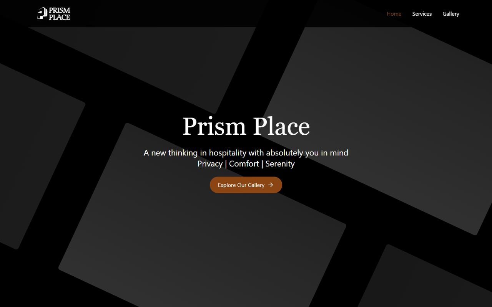

# Prism Place

Marketing website for Prism Place, a hospitality business. It presents the property, its services and a photo gallery. This was an early project of mine, from 2025.

**Live:** [prism-place.vercel.app](https://prism-place.vercel.app)



## Pages

- **Home:** introduction and amenities
- **Services:** what guests can expect
- **Gallery:** photos of the property

## Stack

React, TypeScript, Vite, Tailwind CSS, React Router, Lucide icons

## Running locally

```sh
npm ci
npm run dev
npm run build
npm run lint
```

No environment variables are needed. The project has no automated tests.
